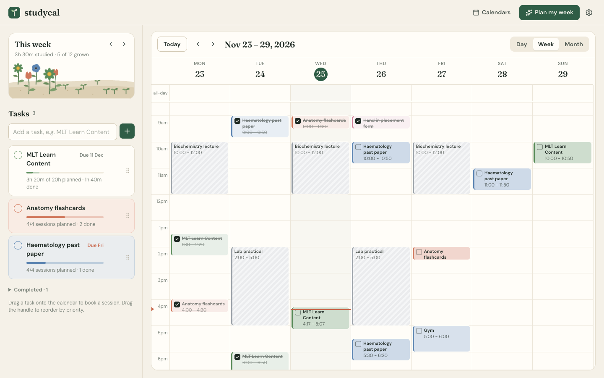

# studycal

**Plan your study around your timetable.** studycal combines a to-do list, a calendar and a focus timer, so you can see when you're actually free, fit your revision into those gaps, and get through it. A small garden grows as you work.

**Use it:** https://gayathrib17.github.io/studycal/



## Why

Uni timetables, deadlines and "I should really revise for that" don't live in the same place. Most planners either make you schedule every block by hand or hide everything behind a list. studycal puts your study tasks next to your real timetable. You can drag work into free time yourself, or let the planner lay out a balanced week that still meets your deadlines.

## Features

- **Tasks that match how you think.** "MLT content, 20 hours" or "Past papers, 9 × 50 min", with an optional due date and a colour. Each task shows how much is planned and how much is done.
- **Your timetable, imported.** Upload an `.ics` file or paste a calendar link from your uni portal, Google, Outlook or Apple Calendar. Repeating lectures, cancelled weeks and time zones are handled.
- **Skip one lecture, not all of them.** Click any imported event to skip just that one, or hide the whole series. You can undo it or restore it any time.
- **Drag and drop.** Drag a task onto the calendar to book a session. Drag sessions to move them, or drag the bottom edge to resize. Times snap to quarter hours.
- **Click to add.** Click empty time to add an event or reminder ("Gym", "Hand in form"), or to book a study session.
- **Plan my week.** Fills your free time for the next two weeks:
  - mixes subjects through each day,
  - gives tasks that are due soon more time,
  - keeps lunch and dinner free,
  - keeps lighter days light,
  - always shows you a preview before changing anything.
- **Focus timer.** Start any session for a focus and break timer. A flower grows as you focus.
- **Weekly garden.** Every finished session plants a flower: each subject has its own flower and colour, and longer sessions grow bigger ones. A new garden starts every Monday.
- **Reminders** when a session or event starts (while the site is open), with optional desktop notifications.
- **Works on your phone.** Once the page is open, it keeps working without an internet connection.

## How to use it

1. **Add your timetable.** Click **Calendars** (top right). Upload an `.ics` file, or paste a subscription link (`webcal://…` or `https://….ics`).
   - *Uni timetable:* look for "Subscribe", "Export to calendar" or "iCal" in your timetable portal.
   - *Google Calendar:* Settings → your calendar → *Integrate calendar* → "Secret address in iCal format".
   - *Outlook:* Settings → Calendar → Shared calendars → *Publish a calendar* → ICS link.
   - *Apple Calendar:* File → Export → Export….

   Some calendar servers don't let websites read their links. If so, studycal will tell you, and you can download the file and upload it instead.
2. **Add your tasks** in the panel on the left. Type a name, then choose either total hours or a number of sessions. Add a due date if there is one. Drag the handle on the right of a task to reorder by priority (top = most important).
3. **Schedule them.** Either:
   - drag a task onto a free slot in the calendar, or
   - click **Plan my week**, choose your weekly rhythm (Normal, Light or Off for each day) and breaks, then **Preview plan**. Suggested sessions appear dashed. Click **Add to calendar** to keep them, or **Discard**.
4. **Study.** Press ▶ on a session (or open it and choose **Start focus**) to start the timer. When it ends, tick the session off and a flower is planted in this week's garden.
5. **Tick things off.** Every block on the calendar has its own tick box. Tick the circle next to a task when the whole thing is done.

### Tips

- **Changed your mind?** Deleting or hiding anything shows an **Undo** button.
- **Re-plan anytime.** After changing your study hours or rhythm, run **Plan my week** again with "Rearrange" ticked. Sessions the planner placed move, and anything you placed yourself stays put.
- **Settings** (gear icon): study hours, meal times, how long sessions and breaks are, and how much to study per day.
- **Back up your data** from Settings → *Your data* now and then, or to move to another device (see below).

## Your data and privacy

- Everything you add (tasks, sessions, events and imported calendars) is stored **only in your own browser** on the device you're using. It isn't sent to a server, and nobody else can see it.
- Because of that, your phone and laptop don't share data yet. Use **Download backup** and **Restore backup** in Settings to move between devices.
- Clearing your browser's site data for studycal deletes your planner, so keep a backup.
- No accounts, no ads, no tracking. Fonts are bundled with the site, so no third party is contacted when you visit.
- Optional sign-in with sync across devices is planned.

## Good to know

- Reminders only work while studycal is open in a tab.
- All-day imported events (holidays, birthdays) are shown but don't block study time.
- Subscribed calendars don't update by themselves. Press **Refresh** next to a calendar in **Calendars** to pull changes.

---

## For developers

### Run it locally

Requires Node.js 22.12 or newer (24 recommended).

```bash
npm install
npm run dev          # http://localhost:5173
```

| Command | What it does |
| --- | --- |
| `npm run dev` | Development server with hot reload |
| `npm test` | Unit tests (Vitest) |
| `npx vitest run src/lib/scheduler.test.ts` | Run one test file |
| `npx vitest run -t "keeps lunch free"` | Run tests whose name matches |
| `npm run typecheck` | TypeScript check |
| `npm run build` / `npm run preview` | Production build, served at http://localhost:4173 |

### Host your own copy

studycal is a static website, so any static host works. The build uses relative paths, so it can live at a domain root or a sub-path. Both included pipelines run the type check and tests before publishing.

- **GitHub Pages** (`.github/workflows/deploy.yml`): in your repository, go to **Settings → Pages → Source: GitHub Actions**, then push to `main`. The site appears at `https://<user>.github.io/<repo>/`.
- **GitLab Pages** (`.gitlab-ci.yml`): push to your project's default branch. The link is under **Deploy → Pages**. Set Pages visibility to *Everyone* to share it.

### How it works

- React + TypeScript, built with Vite.
- The calendar is [FullCalendar](https://fullcalendar.io/) (MIT parts only), and calendar files are read with [ical.js](https://github.com/kewisch/ical.js).
- State lives in a single [zustand](https://github.com/pmndrs/zustand) store, saved to local storage.
- The planner, calendar import, garden and timer logic are plain TypeScript in `src/lib/`, covered by unit tests.

[docs/DESIGN.md](docs/DESIGN.md) explains how the planner decides where sessions go, why the app is built the way it is, the design principles, and the roadmap.

### Feedback

Found a bug or have an idea? [Open an issue](https://github.com/gayathrib17/studycal/issues).
